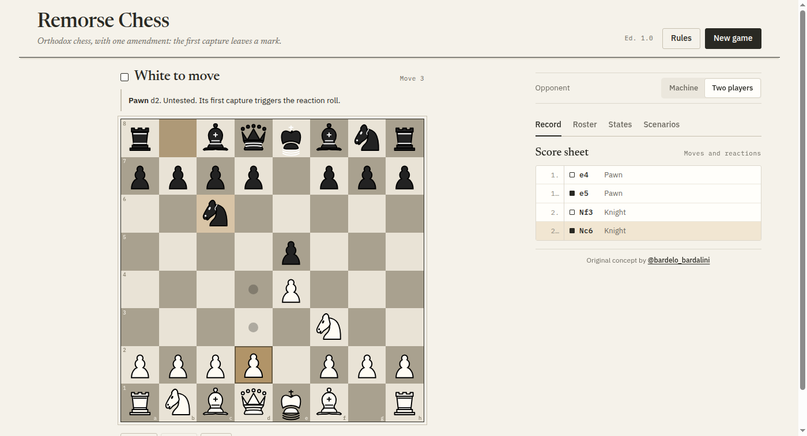
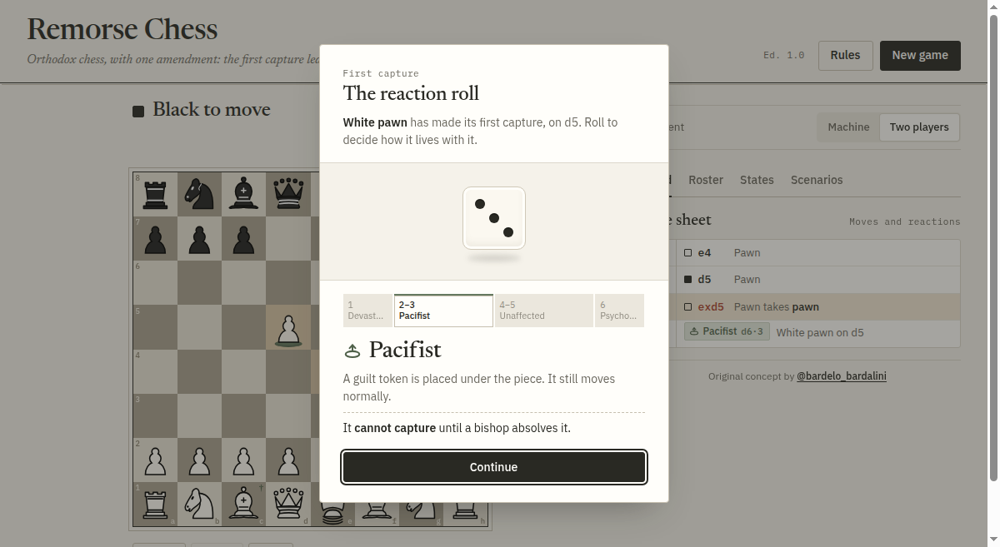
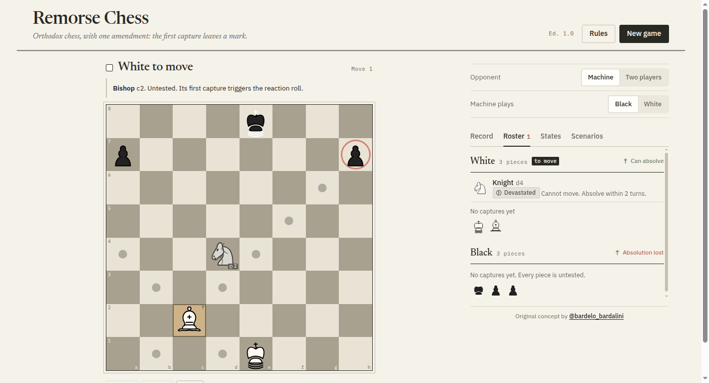
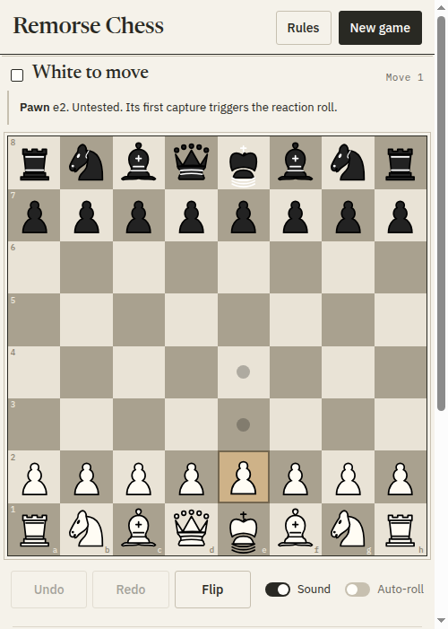

# Remorse Chess (Version 1.0)

An interactive, light archival editorial implementation of **Remorse Chess**, an orthodox chess variant in which pieces develop psychological consequences and moral crises upon taking another piece's life.

> **Credits & Original Concept:**
> The remorse game mechanics, capture consequences, and psychological classification system were created by **[@bardelo_bardalini](https://www.instagram.com/bardelo_bardalini/)**.

---

## Visual Preview

| Match Board & Score Sheet | 3D Reaction Roll (D6) |
| :---: | :---: |
|  |  |

| Tactical Scenarios & Living Roster | Mobile View |
| :---: | :---: |
|  |  |

---

## Overview & Core Rules

Remorse Chess is played according to orthodox chess rules (objective: checkmate the opponent's king), modified by the psychological reactions of individual pieces after capturing.

### 1. The D6 Capture Reaction Roll
Whenever a piece makes its **first capture** of the game, a six-sided die (d6) is rolled to determine its permanent psychological condition:

| D6 Roll | Reaction | Effect |
| :---: | :--- | :--- |
| **1** | **Devastated** | Completely immobilized (cannot move or capture). Must be absolved by an adjacent Bishop within 3 of the owner's turns, or it **self-captures in despair** and is removed from the board. |
| **2–3** | **Guilt-Ridden** | Overcome with remorse. Receives a **Guilt Token** beneath it. Becomes a **Pacifist**: moves normally, but **cannot capture enemy pieces**. A Bishop must move adjacent and spend 1 turn to absolve it. |
| **4–5** | **Unaffected** | Cold indifference to slaughter. Continues functioning according to standard orthodox chess rules. |
| **6** | **Psychopath** | Discovers an ecstatic thrill in killing! Immediately receives **one bonus move** after capturing (can move or capture again). |

*Note on Permanent Assignment:* Each piece receives only one reaction roll per game. An absolved piece retains its assigned psychological reaction type, but has its debuff resolved.

---

### 2. Psychological Conditions & Absolution

- **Devastation Deadline:** Only the affected player's turns count toward the 3-turn deadline. Opponent turns do not advance the counter.
- **The Absolution Ritual:** Bishops are the only pieces capable of performing absolution. A bishop must move adjacent to an affected piece (guilt-ridden or devastated) and spend one full turn performing absolution.
- **Bishop's Own Guilt:** If a bishop captures an enemy piece and becomes guilt-ridden, it spends its next turn cleansing its conscience through meditation and automatically absolves itself after that turn.
- **Devastated Bishop:** A devastated bishop can be absolved by another friendly bishop.
- **Loss of Bishops:** If all of a player's bishops are slain, the player loses the ability to absolve affected pieces until a pawn successfully promotes into a bishop.
- **Bloodlust Progression (The 3-Kill Debuff):** Once a psychopath claims 3 total kills, it unlocks **Bloodlust**:
  - The piece can **ONLY move if it is capturing another piece** (no quiet moves).
  - It is willing to capture **both enemy and friendly pieces** (cannibalism).
  - It **cannot capture its own king**.
  - It retains its psychopath bonus move after each capture.
- **Pawn Promotion:** Follows standard chess rules (Q, R, B, N). Promoted pieces have no previous capture history and start psychologically fresh. Promoting to a Bishop restores absolution capabilities if all previous bishops were lost.

---

## Features of this Implementation

1. **Light Archival Editorial Design:**
   - Visual identity inspired by historical tournament score sheets, annotated manuscripts, and archival records.
   - Warm paper palette (`#F5F2EA` paper, `#FFFEFA` surface, `#292923` ink, `#DCD7CB` rules, with restrained vermilion `#C44B36` and sage `#667A61`).
   - Editorial typography: Newsreader (display), IBM Plex Sans (interface), and IBM Plex Mono (telemetry & notation).
   - Zero framework overhead, zero build dependencies: runs in any modern browser.
2. **Interactive 3D Animated Dice Roller:**
   - Pure CSS 3D tumbling die with authentic indented pips and acoustic tumble rattle.
   - Post-roll probability breakdown scale and clear diagnostic rules copy.
   - Optional Auto-Roll toggle for quick play.
3. **Dedicated Remorse AI (RemorseBot):**
   - Minimax search with alpha-beta pruning.
   - Evaluates piece value, psychological debuffs, bishop rush urgency for dying devastated pieces, psychopath multi-move combos, and bloodlust cannibalism threats.
4. **Interactive Sandbox Scenarios:**
   - Pre-loaded interactive scenarios demonstrating every mechanic in the rulebook:
     - Devastated Knight Survival (Absolution race against the 3-turn countdown)
     - Pacifist Rook Absolution (Guilt token demonstration)
     - Psychopath Chain Reaction (Double-kill bonus move)
     - Bloodlust Friendly Fire (Cannibalistic meal)
     - Standard Orthodox Remorse game
5. **Synthesized Web Audio Soundscape:**
   - Zero external audio files; uses the Web Audio API for rich acoustic piece thuds, tumbling dice rattle, mournful chords, absolution chimes, blade slices, and self-capture crumble.
6. **Tournament Score Sheet & Tactical Roster:**
   - Annotated chronicle tracking moves, captures, dice rolls, absolution rites, and tragedies.
   - Tactical Roster showing living roster by side, absolution capability flags, kills, and urgency indicators.
7. **Complete Official Rulebook Viewer:**
   - Integrated modal with full Version 1.0 rules and original concept attribution.
8. **Automated Unit Test Suite:**
   - 14 automated test suites verifying all rules and edge cases with 100% pass rate.

---

## Running the Application Locally

```bash
# Python 3
python3 -m http.server 8089

# Or Node.js
npx serve -l 8089 .
```

Then open `http://localhost:8089` in your browser.

### Run the Rulebook Unit Test Suite

```bash
node test_remorse_rules.js
```
